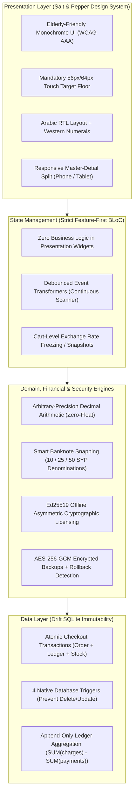

# دكّاني (Dukkani) — Architecture & System Documentation Hub

**Offline-First Syrian POS, Multi-Currency Engine & Inflation-Protected Debt Ledger**

  A mission-critical Flutter retail management system engineered specifically for neighborhood grocery stores (<em>Sammaneh</em> / بقالية) operating in hyper-volatile, multi-currency economies.

[-003B57?style=for-the-badge&logo=sqlite&logoColor=white)](./docs/ARCHITECTURE.md)

---

## 📌 Repository Overview

This repository contains the **complete technical documentation suite, architecture specifications, design system guides, and architectural decision records (ADRs)** for **Dukkani (دكّاني)**.

> 🔒 **Notice**: The core application source code is maintained in a private repository for commercial licensing and proprietary reasons. This public repository serves as an open architecture reference, case study, and technical portfolio showcase.

---

## 📚 Deep-Dive Documentation Index

Explore the comprehensive technical case study, financial math formulas, SQLite schemas, and UI design specifications:

| Document | Key Topics & Engineering Highlights |
| :--- | :--- |
| **[📑 Full Case Study](./docs/CASE_STUDY.md)** | Syrian hyperinflation context, currency redenomination, problem space, core solution pillars, and operational impact. |
| **[🏗️ System Architecture](./docs/ARCHITECTURE.md)** | Clean Architecture layers, strict BLoC state management rules, Drift SQLite schema, ER diagram, and 4 native immutability triggers. |
| **[💰 Financial Math & Cryptography](./docs/FINANCIAL_AND_SECURITY.md)** | Zero-floating-point `Decimal` math engine, 50-step cyclic banknote snapping, Ed25519 offline asymmetric licensing, and PBKDF2/AES-256-GCM backups. |
| **[🎨 "Salt & Pepper" Design System](./docs/DESIGN_SYSTEM.md)** | WCAG AAA contrast, 56px/64px accessibility touch target floor, RTL Arabic with Western numerals, and 320px–Tablet responsiveness. |
| **[🛍️ Features & Operational Flows](./docs/FEATURES_AND_FLOWS.md)** | Walkthrough of POS, Held Carts, Continuous Scanner, Weight Calculator, Append-Only Ledger, and WhatsApp statements. |
| **[⚖️ ADRs & Testing Strategy](./docs/ADR_AND_TESTING.md)** | 5 Architecture Decision Records (ADRs) and comprehensive automated testing strategy across 44 test suites. |
| **[💼 Portfolio & Resume Snippets](./docs/PORTFOLIO_SNIPPETS.md)** | Ready-to-copy website cards, JSON/MDX frontmatter, impact-driven resume bullets, and 4 STAR interview stories. |
| **[📸 Screenshot Asset Guide](./docs/assets/screenshots/README.md)** | Standardized shot list, file naming conventions, and layout dimensions for showcase images. |

---

## ⚡ System Architecture at a Glance

---

## 🛡️ Core Engineering Guarantees

1. **Zero Floating-Point Financial Math (`0` Double Policy):**
   - No `double` or `num` types are used for monetary amounts anywhere in the domain or data layers.
   - All financial math is computed via arbitrary-precision `Decimal` objects and stored as exact `TEXT` in SQLite via custom Drift converters.

2. **Immutable Append-Only Customer Debt Ledger (*الدفتر*):**
   - Customer balances are never updated in-place via `UPDATE customers SET balance = ...`.
   - Outstanding balances are computed dynamically through SQL aggregations (`SUM(charges) - SUM(payments)`) over an append-only transaction ledger.
   - 4 native SQLite database triggers actively reject any SQL `UPDATE` or `DELETE` statements on closed invoices and ledger entries.

3. **Smart Syrian Banknote Snapping Algorithm:**
   - In cash checkout mode, invoice totals automatically snap to the nearest physical banknote denomination (configurable to **10**, **25**, or **50 SYP**).
   - Eliminates fractional coin debt that cannot be physically settled in cash, while preserving exact line-item precision in the underlying ledger.

4. **100% Offline Cryptographic Licensing:**
   - Commercial activation runs completely air-gapped without requiring an internet connection or activation servers.
   - Hardware device fingerprint concatenated with license payload is cryptographically validated using asymmetric **Ed25519** public key signatures.
   - SQLite monotonic timestamp watermarks prevent clock-tampering attacks.

5. **"Salt & Pepper" Accessibility Design System:**
   - Designed for shopkeepers working in direct sunlight or dimly lit kiosks.
   - Zero gradients, zero elevation drop-shadows, and strict `1.5px` high-contrast solid borders.
   - Mandatory minimum touch targets of `56px` for controls and `64px` for primary checkout buttons.

---

## 🛠️ Technology Stack

| Layer | Technology | Purpose & Implementation |
| :--- | :--- | :--- |
| **Framework** | [Flutter](https://flutter.dev) (SDK ^3.10.0) | Multi-platform declarative UI engine targeting Android POS terminals and tablets |
| **Language** | [Dart](https://dart.dev) (3.x) | Strict type-safety with `strict-casts`, `strict-inference`, and `strict-raw-types` enabled |
| **State Management** | [flutter_bloc](https://pub.dev/packages/flutter_bloc) | Unidirectional data flow with strict separation between UI events and domain state |
| **Local Database** | [Drift](https://drift.simonbinder.eu/) (`sqlite3`) | Type-safe reactive SQLite ORM with custom type converters and atomic transactions |
| **Financial Engine** | [decimal](https://pub.dev/packages/decimal) | Arbitrary-precision decimal calculations preventing binary floating-point drift |
| **Cryptography** | [cryptography](https://pub.dev/packages/cryptography) | Ed25519 digital signature verification and PBKDF2 / AES-256-GCM database encryption |
| **Service Locator** | [get_it](https://pub.dev/packages/get_it) | Dependency injection decoupling data sources, repositories, and presentation blocs |
| **Screen Adaptation** | [flutter_screenutil](https://pub.dev/packages/flutter_screenutil) | Responsive scaling across mobile (320px–480px) and POS terminals (600dp–1200dp) |

---

## 📄 License & Attribution

All documentation, architecture diagrams, and design specifications in this repository are published under the **MIT License**.

The core **Dukkani** application, compiled binaries, and proprietary source code remain the exclusive intellectual property of the author.

---

  Engineered by <strong>Laith Mh</strong> • Aleppo / Damascus Market Architecture Focus

