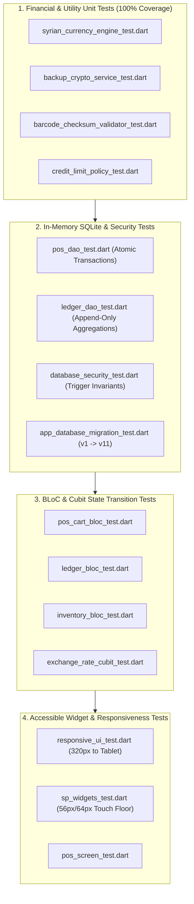

# ⚖️ Architecture Decision Records (ADRs) & Testing Strategy
## Rigorous Decisions & 44 Automated Test Suites

---

## 📋 Architecture Decision Records (ADRs)

### ADR-001: Arbitrary Precision `Decimal` vs. IEEE 754 `double`
- **Status:** Accepted & Enforced
- **Context:** Currency conversion between USD and SYP involves numbers ranging from fractions of a cent ($0.001) to millions of Syrian Pounds. Dart `double` uses 64-bit binary floating-point representation, causing cumulative errors (`0.1 + 0.2 = 0.30000000000000004`).
- **Decision:** Strictly ban `double` and `num` across all domain entities, calculation utilities, and database tables. Enforce the `decimal` package in Dart, and persist values as `TEXT` in SQLite via Drift's `DecimalConverter`.
- **Consequences:** Eliminates rounding drift across multi-currency checkouts; requires explicit division scale handling (`scaleOnInfinitePrecision: 12`).

---

### ADR-002: Append-Only Ledger with Triggers vs. Mutable Customer Balance Column
- **Status:** Accepted & Enforced
- **Context:** Traditional retail apps store a mutable `current_balance` column on the `customers` table. Any app crash, concurrency glitch, or unhandled exception during checkout risks desynchronizing this balance from actual invoice history.
- **Decision:** Disallow any balance column on `customers`. Compute customer debt balances dynamically through SQL aggregations (`SUM(charges) - SUM(payments)`) over an append-only `customer_ledger_table`. Install native SQLite triggers preventing row deletion and unauthorized updates.
- **Consequences:** 100% auditability and zero balance corruption; voids and corrections require explicit compensating entries (`charge_reversal`, `payment_reversal`).

---

### ADR-003: Cart Snapshot Exchange Rate vs. Reactive Live Rate Mutation
- **Status:** Accepted & Enforced
- **Context:** If a cashier begins ringing up items for a customer, and another staff member updates the global exchange rate in the top bar, auto-updating the open cart mid-checkout creates cashier confusion, altered totals, and receipt disputes.
- **Decision:** Lock a snapshot of the active exchange rate inside `PosCartState` upon cart creation. If the global rate changes, display a non-blocking `PosStaleRateBanner` allowing the cashier to explicitly refresh prices or proceed with the agreed rate.
- **Consequences:** Guarantees transaction consistency while keeping the cashier informed of currency movement.

---

### ADR-004: Asymmetric Ed25519 Cryptography vs. Online Licensing Server
- **Status:** Accepted & Enforced
- **Context:** Neighborhood grocery stores in Syria face prolonged internet blackouts and power cuts. Standard licensing SDKs that require periodic online validation would brick the app during daily sales operations.
- **Decision:** Implement an offline asymmetric digital signature scheme using `Ed25519`. The app embeds only the vendor's 32-byte public key. Licenses are cryptographically bound to hardware device fingerprints and validated against multi-table SQLite high-water mark timestamps to prevent clock-rollback tampering.
- **Consequences:** Zero cloud infrastructure required; 100% offline license validation that cannot be bypassed by device clock changes.

---

### ADR-005: "Salt & Pepper" High-Contrast Monochrome vs. Material 3 Shadows
- **Status:** Accepted & Enforced
- **Context:** Target users are older adults (50–70 years old) operating under extreme lighting variations (direct Mediterranean sunlight or dim battery-powered LEDs during power rationing) on low-end Android phones.
- **Decision:** Replace decorative drop shadows, gradients, and low-contrast animations with the "Salt & Pepper" design system: `#FFFFFF` surfaces, `#2B2B2B` charcoal text/buttons, `1.5px` solid borders, and strict `56px`/`64px` touch targets.
- **Consequences:** Superior readability and WCAG AAA compliance; eliminates UI rendering overhead on budget phone GPUs.

---

## 🧪 Comprehensive Automated Testing Strategy

The repository contains **44 automated test files** covering financial math, database migrations, security triggers, BLoC state transitions, and responsive accessibility constraints.



### 1. In-Memory Drift SQLite Verification (`NativeDatabase.memory()`)
Tests DAOs without touching physical disk storage, verifying:
- Atomic checkout transactions rolling back inventory on debt errors.
- SQLite triggers aborting `DELETE` or `UPDATE` queries on `customer_ledger_table`.
- Correct aggregation of balances across multiple charges, payments, and reversals.

### 2. Financial Boundary Testing (`SyrianCurrencyEngineTest`)
- Banknote rounding boundaries: `14 SYP` $\rightarrow$ `20 SYP`, `22.5 SYP` $\rightarrow$ `25 SYP`, `27.5 SYP` $\rightarrow$ `30 SYP`.
- Bulk weight reverse calculations: converting exact cash amounts to grams precision (`0.001 kg`).
- Zero division safety and multi-currency exchange rate conversions.

### 3. Accessible UI & Responsiveness Testing
- Validates that touch targets never shrink below `56px` (`64px` for checkout) even on ultra-compact 320px screens.
- Verifies Western numeral input filtering and Eastern-to-Western Arabic digit normalization on keystroke.

### Executing the Test Suite
```bash
# Run all unit, database, bloc, and widget tests
flutter test

# Run static analysis with strict type checking
flutter analyze
```

