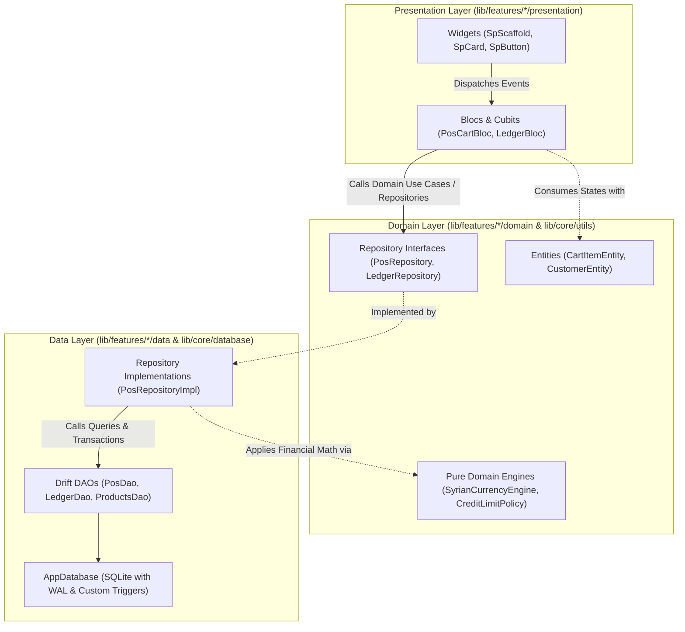
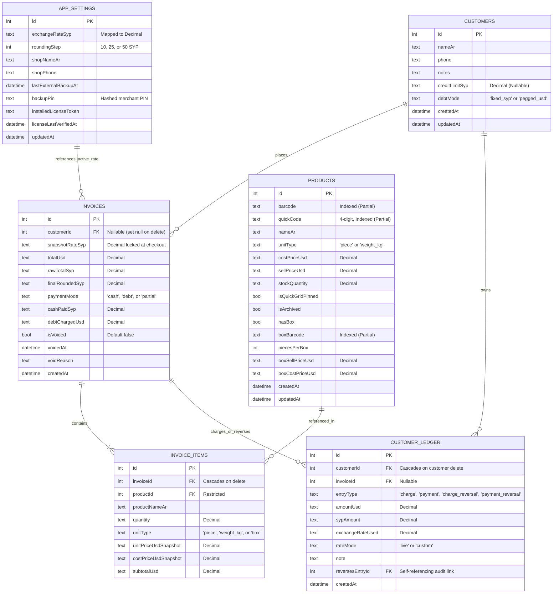
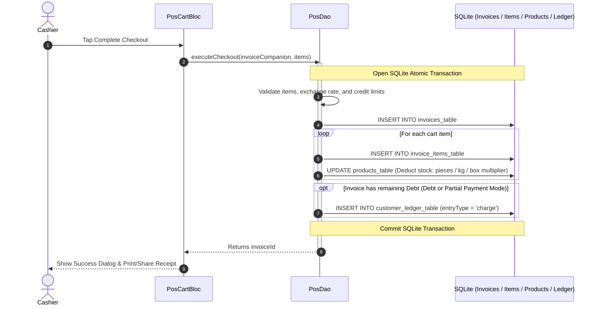

# 🏗️ System Architecture & Data Layer
## High-Reliability Clean Architecture & SQLite Immutability

---

## 🏛️ Clean Architecture & Layer Responsibilities

Dukkani strictly adheres to **Feature-First Layered Clean Architecture**. Dependencies point strictly inwards: UI widgets never interact with the database, and domain entities contain zero platform or persistence code.



### 1. Presentation Layer (`lib/features/<feature>/presentation/`)
- **Strict SRP Widgets:** Monolithic screen files are strictly prohibited. Screens compose modular widgets located in `presentation/widgets/`.
- **Zero Business Logic in UI:** Widgets do not contain calculations, filtering loops, or formatters. All queries, searches, and counts are processed in BLoCs or state getters.
- **Event Debouncing inside BLoC:** Search keystrokes and barcode scanners trigger immediate events; debouncing is implemented via custom `EventTransformer` instances inside the BLoC (e.g. `_debounce(...)`), keeping UI controllers clean of `Timer` state.
- **Deduplicated Feedback (`listenWhen`):** To prevent duplicate SnackBar notifications on state updates, consumers strictly evaluate `listenWhen: (prev, curr) => prev.actionMessageAr != curr.actionMessageAr && curr.actionMessageAr != null`.

### 2. Domain Layer (`lib/features/<feature>/domain/`)
- Contains pure Dart business entities (`Equatable`), repository contracts, and pure calculation engines.
- Completely decoupled from Flutter framework code and external packages (except pure math packages like `decimal`).

### 3. Data Layer (`lib/features/<feature>/data/` & `lib/core/database/`)
- Manages local SQLite storage through **Drift**.
- Implements atomic database transactions, custom SQLite converters (`DecimalConverter`), and immutability triggers.

---

## 🗄️ Database Architecture & Entity-Relationship Model

The application database is powered by SQLite with **Write-Ahead Logging (`PRAGMA journal_mode = WAL`)**, foreign keys strictly enabled, and in-memory temporary storage (`PRAGMA temp_store = MEMORY`) to ensure instant writes during high-throughput checkouts.



---

## 🔒 Database Safety Triggers (Immutability by Design)

Rather than relying purely on application-level validations, Dukkani installs **4 native SQLite Triggers** directly in the database engine (`AppDatabase.createDataSafetyTriggers`). This guarantees that financial integrity cannot be violated by rogue queries, bugs, or third-party database inspectors.

### 1. `trg_ledger_no_delete`
Prevents direct deletion of rows from `customer_ledger_table`. Once a charge or payment is recorded, it can only be neutralized via an explicit reversing entry.
```sql
CREATE TRIGGER IF NOT EXISTS trg_ledger_no_delete
BEFORE DELETE ON customer_ledger_table
BEGIN
  SELECT RAISE(ABORT, 'لا يمكن حذف السجلات المالية من دفتر الديون - استخدم القيد العكسي أو الإلغاء');
END;
```

### 2. `trg_ledger_no_update`
Prevents altering existing ledger rows (protecting `customer_id`, `entry_type`, `syp_amount`, `exchange_rate_used`, and `reverses_entry_id`). An exception is carved out strictly for automatic floating-point precision healing.
```sql
CREATE TRIGGER IF NOT EXISTS trg_ledger_no_update
BEFORE UPDATE ON customer_ledger_table
FOR EACH ROW
WHEN (
  OLD.customer_id != NEW.customer_id OR
  OLD.entry_type != NEW.entry_type OR
  OLD.syp_amount != NEW.syp_amount OR
  OLD.exchange_rate_used != NEW.exchange_rate_used OR
  (OLD.reverses_entry_id IS NOT NULL AND OLD.reverses_entry_id != NEW.reverses_entry_id) OR
  (OLD.amount_usd != NEW.amount_usd AND (
    OLD.syp_amount IS NULL OR
    OLD.exchange_rate_used IS NULL OR
    CAST(OLD.syp_amount AS REAL) <= 0.0 OR
    CAST(OLD.exchange_rate_used AS REAL) <= 0.0 OR
    ABS(CAST(NEW.amount_usd AS REAL) - (CAST(OLD.syp_amount AS REAL) / CAST(OLD.exchange_rate_used AS REAL))) > 0.01
  ))
)
BEGIN
  SELECT RAISE(ABORT, 'بيانات الحركات المالية في دفتر الديون غير قابلة للتعديل للحفاظ على النزاهة المحاسبية');
END;
```

### 3. `trg_invoices_no_delete` & `trg_invoices_immutable_amounts`
Issued invoices cannot be deleted; they must be marked `isVoided = 1` via an atomic reversal transaction. Crucial monetary amounts (`total_usd`, `final_rounded_syp`, `cash_paid_syp`, `debt_charged_usd`) are permanently locked upon invoice creation.

---

## ⚡ Atomic Transactions

All multi-step financial operations run inside Drift `transaction(() async { ... })` blocks. If any validation fails or hardware crashes mid-operation, SQLite rolls back every mutation, preventing orphaned invoices or inconsistent inventory levels.

### 1. POS Checkout Transaction (`PosDao.executeCheckout`)



### 2. Invoice Voiding Transaction (`PosDao.voidInvoice`)
1. Checks whether invoice is already voided (`ValidationFailure` if true).
2. Reads all original `invoice_items_table` entries and restores stock in `products_table` (multiplying full cartons by `piecesPerBox` when applicable).
3. If the invoice recorded a debt entry, inserts a compensating `charge_reversal` row in `customer_ledger_table` linked to the original entry via `reversesEntryId`.
4. Updates `invoices_table` setting `isVoided = true`, `voidedAt = now`, and `voidReason`.

---

## 🏎️ Database Performance Tuning

- **Partial Unique Indexes:** Unique constraints on product barcodes and quick codes are scoped with `WHERE is_archived = 0`, allowing merchants to archive discontinued products without barcode collisions:
  ```sql
  CREATE UNIQUE INDEX ux_products_quick_code ON products_table(quick_code) WHERE is_archived = 0;
  CREATE UNIQUE INDEX ux_products_barcode ON products_table(barcode) WHERE is_archived = 0 AND barcode IS NOT NULL AND barcode != '';
  ```
- **Composite Indexes:** Optimized for rapid customer ledger timeline queries:
  ```sql
  CREATE INDEX ix_ledger_customer_created ON customer_ledger_table(customer_id, created_at DESC);
  ```
- **Lightweight Reactive Streams:** In `LedgerDao.watchCustomersWithDebt()`, rather than performing heavy row joins across thousands of entries, a trigger query subscribes to table invalidations, executing an optimized column-only extraction to compute customer balances in milliseconds.

