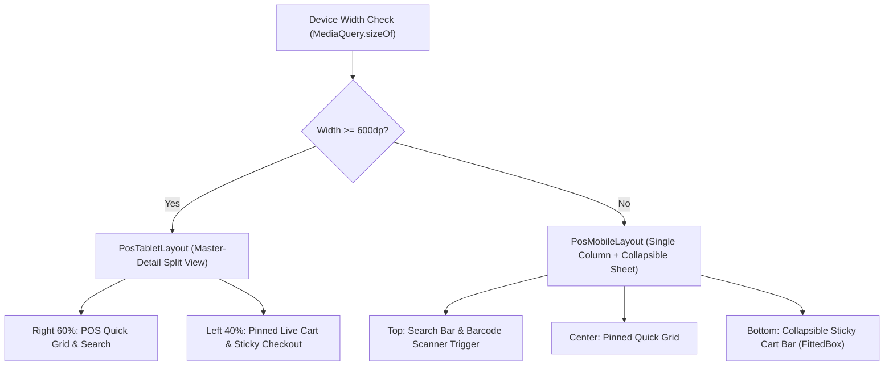

# 🎨 "Salt & Pepper" UI/UX Design System
## High-Contrast, Zero-Friction Ergonomics for Elderly Merchants

---

## 🎯 Design Philosophy & Problem Statement

Neighborhood grocery store owners in Syria face unique physical and environmental constraints:
- **Demographics:** Many merchants are between 50 and 70 years old, often experiencing declining vision and diminished fine motor skills.
- **Lighting Extremes:** Shops operate under harsh direct sunlight through streetfront doors or in dim rooms during rolling power cuts with minimal battery-powered LED strips.
- **Hardware Constraints:** Budget Android phones with low peak screen brightness and compact displays (as narrow as 320 logical pixels).
- **Checkout Speed:** Long queues form during evening rush hours; merchants cannot afford to squint at low-contrast gray text or search through nested menus.

The **"Salt & Pepper"** design system discards contemporary trends (glassmorphism, subtle shadows, low-contrast gray-on-gray typography, tiny icon buttons) in favor of **hyper-readable monochrome surfaces, high-contrast borders, tactile 56px/64px touch targets, and zero visual clutter**.

---

## 🎨 Color Palette & WCAG AAA Contrast Ratios

The palette is strictly limited to four core monochrome tones and two high-contrast semantic accents:

```text
┌────────────────────────────────────────────────────────┐
│  Salt White (#FFFFFF) — Primary Surface & Cards        │
├────────────────────────────────────────────────────────┤
│  Dark Pepper (#2B2B2B) — Charcoal Text & Action Buttons│
├────────────────────────────────────────────────────────┤
│  Light Pepper (#D4D4D4) — Solid 1.5px Borders & Dividers│
├────────────────────────────────────────────────────────┤
│  Medium Pepper (#B3B3B3) — Disabled States & Placeholders│
├──────────────────────────┬─────────────────────────────┤
│  Debt Red (#B91C1C)      │  Paid Green (#15803D)       │
│  Overdue / Ledger Charge │  Paid Cash / Success State  │
└──────────────────────────┴─────────────────────────────┘
```

| Color Token | Hex Code | Usage | Contrast vs White (#FFFFFF) | WCAG Level |
| :--- | :--- | :--- | :--- | :--- |
| **Dark Pepper** | `#2B2B2B` | Primary text, primary buttons, headers | **14.1 : 1** | **AAA (Pass)** |
| **Debt Red** | `#B91C1C` | Outstanding debt, void warnings, errors | **5.7 : 1** | **AAA Large / AA (Pass)** |
| **Paid Green** | `#15803D` | Cash received, fully paid, success | **4.7 : 1** | **AA (Pass)** |
| **Light Pepper** | `#D4D4D4` | Solid 1.5px card & input borders | Structural border demarcation | High Tactility |

### The "Zero Drop Shadow" Rule
- Material elevation is set to `0` everywhere (`elevation: 0`).
- Surface separation is achieved exclusively through **`1.5px` to `2.5px` solid borders** (`AppColors.lightPepper` and `AppColors.darkPepper`), guaranteeing sharp visibility even on washed-out budget LCD screens.

---

## 👆 The Elderly Accessibility Floor

In standard consumer apps, buttons frequently measure 36px to 44px in height. For older merchants with tremors or thick fingers, small buttons lead to missed taps and frustration.

Dukkani enforces a strict architectural floor in [`AppSpacing`](file:///d:/flutter_projects/Dukkani/lib/core/constants/app_spacing.dart):

```dart
// Minimum height for any interactive list tile, icon, or secondary button
static const double minTouchTarget = 56.0;

// Primary modal action buttons
static const double primaryButtonHeight = 58.0;

// Primary POS checkout execution button
static const double checkoutButtonHeight = 64.0;
```

To ensure buttons never scale down below these physical minimums on compact screens, responsive helpers use a strict mathematical floor:
```dart
static double get responsiveMinTouchTarget =>
    math.max(minTouchTarget, minTouchTarget.hSafe);

static double get responsiveCheckoutButtonHeight =>
    math.max(checkoutButtonHeight, checkoutButtonHeight.hSafe);
```

---

## 🔤 Localization & Western Numeral Ergonomics

- **Primary Locale:** Arabic (`RTL` - Right-to-Left).
- **Western Arabic Numerals Rule (`0123456789`):** Eastern Arabic numerals (`٠١٢٣٤٥٦٧٨٩`) have thin strokes and easily confused glyphs on low-resolution phone screens (e.g. `٥` looks like `0`, `٢` and `٣` blur together at distance).
- All numbers, prices, and quantities are rendered strictly using bold Western Arabic numerals for instant clarity.
- When merchants type using standard Arabic keyboards, [`WesternDigitsFormatter`](file:///d:/flutter_projects/Dukkani/lib/core/utils/western_digits_formatter.dart) automatically intercepts and normalizes Eastern digits to Western digits on keystroke.

---

## 📱 Responsive Architecture: Ultra-Compact (320px) to Tablets (600dp+)



### 1. Ultra-Compact Phones (320px–360px Width)
Syrian Pound denominations reach millions of pounds (e.g., `1,500,000 ل.س`). On 320px screens, rigid text easily triggers `RenderFlex` overflows.
- Every financial display widget ([`SpMoneyDisplay`](file:///d:/flutter_projects/Dukkani/lib/core/widgets/sp_money_display.dart)) wraps formatted amounts in `FittedBox(fit: BoxFit.scaleDown)`.
- Action button pairs flex (`Expanded`) or wrap vertically if text labels require space.

### 2. Tablet & POS Terminal Split View (>= 600dp Width)
Instead of stretching single-column mobile views across wide tablet screens, [`PosTabletLayout`](file:///d:/flutter_projects/Dukkani/lib/features/pos/presentation/widgets/pos_tablet_layout.dart) displays a master-detail split layout:
- **Left Column (40%):** Persistent live cart with quantity steppers and pinned 64px checkout button.
- **Right Column (60%):** Large-touch product quick grid, search bar, and barcode trigger.

---

## 🧩 Reusable Component Library (`lib/core/widgets/`)

All UI screens must compose reusable design system components rather than raw Flutter containers:

| Component | Responsibility & Accessibility Feature |
| :--- | :--- |
| **`SpScaffold`** | Screen scaffold with pinned global exchange rate top bar and RTL drawer navigation. |
| **`SpCard`** | Zero-elevation container with `1.5px` Light Pepper border and customizable semantic accents. |
| **`SpPrimaryButton`** | `58px` / `64px` Dark Pepper button with bold text and mandatory leading icon. |
| **`SpSecondaryButton`** | `58px` white surface button with `2.0px` solid Dark Pepper border. |
| **`SpTextField`** | High-contrast text input with automatic Eastern-to-Western digit normalization. |
| **`SpDualCurrencyInput`**| Dual USD and SYP text inputs that dynamically synchronize using the active exchange rate. |
| **`SpMoneyDisplay`** | Dual-line monetary display formatted with `FittedBox` scale-down protection. |
| **`SpConfirmDialog`** | High-contrast confirmation modal requiring explicit confirmation for destructive actions. |
| **`SpEmptyOrErrorState`**| Screen state placeholder with large visual icon and clear Arabic action button. |

