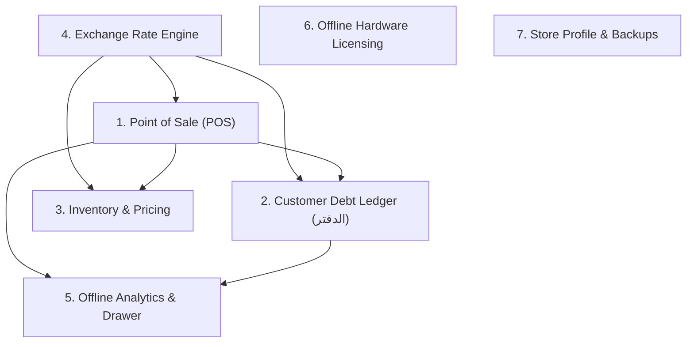
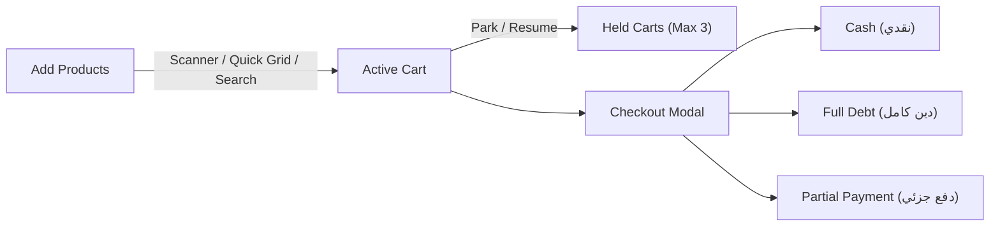
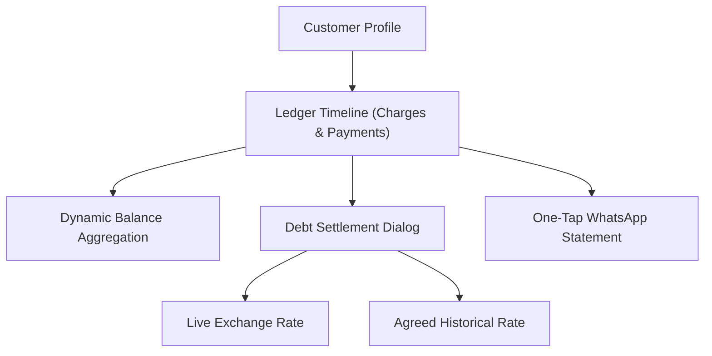

# 🛍️ Features & Operational Workflows
## Complete Functional Tour of Dukkani

---

## 🧭 Application Modules Overview

Dukkani consists of 7 tightly integrated feature modules built for grocery store checkout and ledger accounting:

---

## 1. Fast Point of Sale (POS / نقطة البيع)

The POS interface is optimized for rapid checkout under peak rush-hour conditions.

### Key Capabilities
- **Continuous Camera Barcode Scanner:** High-speed continuous camera viewfinder with target reticle, audio beep, and haptic feedback. Supports instant barcode matching with automated **UPC-A (12-digit) ↔ EAN-13 (13-digit)** normalization.
- **Pinned Quick Grid:** Configurable 2-column or 3-column grid for fast-moving unbarcoded items (fresh bread, eggs, dairy, vegetables) or numeric 4-digit Quick Codes (e.g., `1001`).
- **Multi-Mode Checkout:**
  - **Cash (`نقدي`):** One-tap quick checkout with automated change calculation based on cash received.
  - **Full Debt (`دين كامل`):** Associates invoice with a customer ledger account, validating customer credit limits before execution.
  - **Partial Payment (`دفع جزئي`):** Customer pays an arbitrary SYP cash amount (e.g. pays 15,000 SYP on a 22,000 SYP bill); the unpaid remainder is automatically converted to USD debt at the active cart exchange rate.
- **Held Carts (`تعليق الفاتورة`):** Cashiers can park up to 3 active customer carts when a shopper steps away to grab another item, continuing other checkouts without losing items or rate snapshots.
- **Weight-by-Cash Dialog:** Sells bulk goods either by exact kilograms (`0.350 كغ`) or by entering customer cash (`"Give me 3,000 SYP of sugar"`).
- **Box / Carton Wholesale Chooser:** Supports dual retail/wholesale selling for boxed goods (e.g., selling single cans or an entire carton of 24 cans with automated stock deduction).

> 📸 *Screenshot Placeholder: `docs/assets/screenshots/01_pos_quick_grid.png` & `02_pos_checkout_modes.png`*

---

## 2. Append-Only Customer Debt Ledger (`الدفتر`)

Replaces physical paper debt notebooks with an immutable accounting ledger.

### Key Capabilities
- **Dual Debt Modes:**
  - **USD-Pegged Mode (`محمي بالدولار`):** Automatically protects merchant capital against inflation. Outstanding balance is tracked in USD; settlements convert to SYP at live rate or custom agreed rate.
  - **Fixed-SYP Mode (`مثبّت بالليرة`):** Keeps debts fixed in local currency for customers on fixed salaries.
- **Append-Only Reversals:** Accidental entries or canceled debts cannot be deleted. Cashiers perform an authenticated reversal (`charge_reversal` or `payment_reversal`), recording an immutable audit trail with a mandatory Arabic reason note.
- **One-Tap WhatsApp Statements:** Generates localized Arabic debt statements sent via `whatsapp://send?phone=+963...` deep links with zero internet server dependencies:
  - Concise Balance Reminder
  - Detailed Last 5 Transactions Statement
  - Formal Legal Account Statement
- **Customer Credit Limits:** Enforces soft or hard credit limits in Syrian Pounds, warning cashiers before issuing further debt.

> 📸 *Screenshot Placeholder: `docs/assets/screenshots/05_debt_ledger.png` & `06_customer_statement_whatsapp.png`*

---

## 3. Lean Inventory & Product Management (`المواد والجرد`)

Streamlined stock tracking built specifically for grocery items.

### Key Capabilities
- **Synchronized Dual-Currency Inputs:** When creating or editing products, entering a price in USD automatically calculates the SYP shelf price, and entering a SYP price calculates the base USD cost with zero rounding drift.
- **Wholesale Box Pricing:** Products can optionally define carton packaging (`piecesPerBox`, `boxCostPriceUsd`, `boxSellPriceUsd`, `boxBarcode`).
- **Stock Threshold & Expiry Alerts:** Filter products by Out-of-Stock, Low Stock, or Near Expiration.
- **CSV Import & Export:** Backup product catalog to standard CSV spreadsheets for external stock audits.

> 📸 *Screenshot Placeholder: `docs/assets/screenshots/07_inventory_dual_currency.png`*

---

## 4. Pinned Exchange Rate Engine

- **Global Top-Bar:** The market exchange rate (`1 USD = X SYP`) is persistently visible across all screens.
- **Instant Shelf Re-pricing:** Modifying the global exchange rate immediately updates shelf prices across the entire product catalog in SQLite.
- **Cart Rate Snapshot Isolation:** Active open carts capture the exchange rate at creation. If the merchant updates the exchange rate mid-checkout, the cart displays a `PosStaleRateBanner`, offering a 1-tap refresh or allowing completion at the original rate.

---

## 5. Offline Analytics & Daily Cash Drawer (`الصندوق والأرباح`)

Provides store intelligence without sending data to third-party cloud servers.

### Key Capabilities
- **Daily Cash Drawer Closing (`جرد الصندوق اليومي`):** Calculates expected physical SYP cash in drawer:
  $$\text{Expected Cash} = \sum \text{Invoice Cash Paid} + \sum \text{Debt Settlements Received} - \sum \text{Cash Reversals}$$
- **Real-Time USD Profitability:** Accurately computes net profit in USD by subtracting unit cost snapshots from invoice sale subtotals.
- **Debt Aging Analytics:** Flags overdue customer debts older than 30 or 60 days to prevent bad debt accumulation.
- **Invoice History & Voiding:** Search historical invoices by date or customer, view line-item breakdowns, and atomically void invoices with automatic inventory restoration.

> 📸 *Screenshot Placeholder: `docs/assets/screenshots/08_analytics_and_cash_drawer.png`*

---

## 6. Offline Hardware Licensing & 7. Settings

- **Hardware Fingerprint Binding:** Generates unique machine codes based on device parameters.
- **QR / Text License Activation:** Scan vendor QR code or paste Ed25519 token to unlock the app.
- **AES-256-GCM Encrypted Backups:** Full database backup and restore with optional 4-digit Security PIN and anti-rollback verification.

