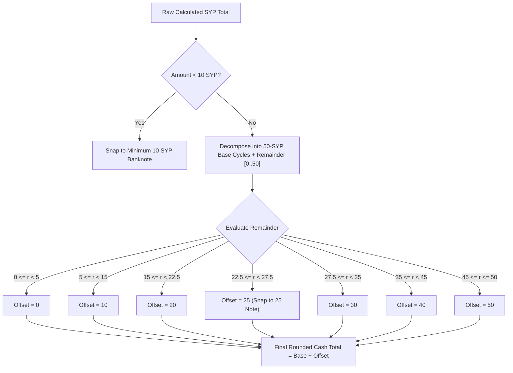
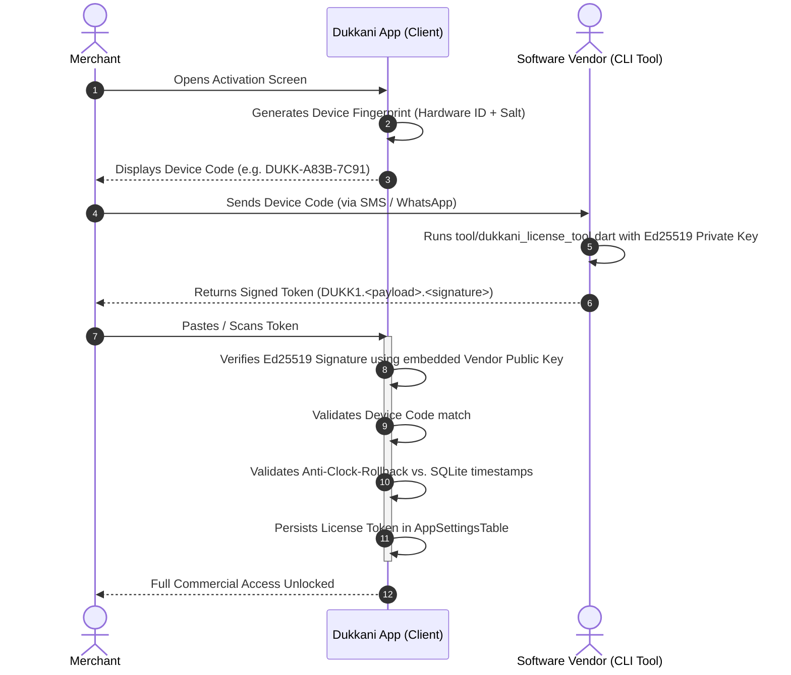

# 💰 Financial Math & Cryptographic Security
## Arbitrary Precision, Denomination Snapping & Zero-Cloud Security

---

## 🧮 Zero-Floating-Point Currency Engine

Standard IEEE 754 floating-point operations (`double` in Dart, `REAL` in SQLite) introduce representation errors that are catastrophic in financial ledgers. For instance, `0.1 + 0.2` evaluates to `0.30000000000000004`. In multi-currency transactions involving millions of Syrian Pounds, these minute inaccuracies cause balancing discrepancies between customer ledger entries and store cash drawer registers.

### Architectural Rules Enforced
1. **Never use `double` or `num` for money, exchange rates, or quantities.**
2. All mathematical operations are executed using the `decimal` package (`Decimal`).
3. Database storage maps `Decimal` to SQLite `TEXT` columns via `DecimalConverter`, preventing SQLite internal floating-point conversions.

```dart
// lib/core/database/converters/decimal_converter.dart
class DecimalConverter extends NullAwareTypeConverter<Decimal, String> {
  const DecimalConverter();

  @override
  Decimal requireFromSql(String fromDb) => Decimal.parse(fromDb);

  @override
  String requireToSql(Decimal value) => value.toString();
}
```

---

## 💵 Smart Syrian Banknote Denomination Snapping

Syrian cash transactions operate without fractional coins. Daily commerce relies on banknotes in denominations of **`10`, `25`, `50`, `100`, `200`, `500` SYP**. 

Standard rounding algorithms (such as rounding to the nearest 10 or 50) either generate unpayable figures (e.g., 35 SYP cannot be paid if the merchant only has 10 and 25 notes) or heavily bias the rounding in favor of the customer or merchant.

### The Algorithm: `_roundToSmartDenominationGrid`
Located in [`SyrianCurrencyEngine`](file:///d:/flutter_projects/Dukkani/lib/core/utils/syrian_currency_engine.dart), this algorithm combines multiples of `10` and `25` SYP into a seamless 50-step cyclic grid:

$$\text{Valid Denominations} \in \{10, 20, 25, 30, 40, 50, 60, 70, 75, 80, 90, 100 \dots\}$$



### Line Item vs. Checkout Total Separation
- **Line items** maintain exact precision rounded to 1 SYP (`convertUsdToExactSyp`).
- **Invoice totals** are snapped to the banknote grid (`convertUsdToFinalRoundedSyp`) only at final checkout, eliminating coin disputes while keeping accounting exact.

---

## ⚖️ Weight & Bulk Calculations from Cash Amounts

In Syrian neighborhood grocery stores, customers frequently purchase dry goods, dairy, or produce not by weight, but by available cash (e.g., *"Give me 5,000 SYP of white cheese"*).

[`SyrianCurrencyEngine.calculateWeightFromSypAmount`](file:///d:/flutter_projects/Dukkani/lib/core/utils/syrian_currency_engine.dart) dynamically solves for weight in kilograms with grams precision (`scale: 3`):

$$\text{PricePerKg}_{\text{SYP}} = \text{PricePerKg}_{\text{USD}} \times \text{ExchangeRate}_{\text{SYP}}$$

$$\text{Weight}_{\text{Kg}} = \left( \frac{\text{Requested}_{\text{SYP}}}{\text{PricePerKg}_{\text{SYP}}} \right) \xrightarrow{\text{round}} 3 \text{ decimal places}$$

---

## 🔐 Offline Cryptographic Licensing (Ed25519)

Dukkani operates in environments with zero cloud connectivity. Standard software licensing systems relying on periodic internet "heartbeat" pings fail in this context. 

To prevent unauthorized distribution while guaranteeing 100% offline functionality, Dukkani uses **Asymmetric Public-Key Cryptography (Ed25519)**.



### 1. Token Specification
- Prefix: `DUKK1`
- Format: `DUKK1.<Base64Url-Encoded-JSON-Payload>.<Base64Url-Encoded-Ed25519-Signature>`
- Public Key: Embedded 32-byte Ed25519 public key in client code (`LicenseVerificationService.defaultVendorPublicKeyBase64`). Private key is kept securely on the vendor's machine.

### 2. Multi-Stage Security Validations
When a token is evaluated in [`LicenseVerificationService.verifyToken`](file:///d:/flutter_projects/Dukkani/lib/core/licensing/services/license_verification_service.dart):
1. **Cryptographic Integrity:** Verifies payload against the vendor's Ed25519 public key.
2. **Device Hardware Binding:** Verifies that `payload.deviceId` matches normalized device fingerprint.
3. **Anti-Clock-Rollback Protection:** Users cannot bypass license expirations by rolling back device system clocks. The engine verifies:
   $$\text{SystemTime} + \text{JitterTolerance} \ge \max(\text{SQLite High-Water Mark Timestamp}, \text{Token Issuance Time})$$
   If system time is earlier than historical invoice timestamps stored in SQLite, the license immediately reports `clockTampered`.

---

## 🛡️ Authenticated Database Backups (AES-256-GCM + PBKDF2)

Grocery ledger data is vital to a merchant's business. Dukkani includes an offline backup engine producing self-contained, authenticated `.dbk` backup archives.

### Binary Envelope Specification (`DUKKDBK1`)
Constructed by [`BackupCryptoService`](file:///d:/flutter_projects/Dukkani/lib/core/utils/backup_crypto_service.dart):

```text
┌───────────────────────┬────────────┬──────────────┬──────────────┬──────────────┬────────────────────────────┐
│ Magic Header (8 Bytes)│ Mode (1 B) │ Salt (16 B)  │ Nonce (12 B) │ MAC (16 B)   │ Ciphertext (Variable)       │
│ "DUKKDBK1"            │ 0x01 / 0x02│ Cryptographic│ Random IV    │ GCM Auth Tag │ Encrypted SQLite Database   │
└───────────────────────┴────────────┴──────────────┴──────────────┴──────────────┴────────────────────────────┘
```

1. **Key Derivation:** Uses `PBKDF2-HMAC-SHA256` with `15,000` iterations and an internal static pepper combined with an optional merchant-defined 4-digit PIN.
2. **Authenticated Encryption:** `AES-256-GCM` produces an authentication tag covering both the ciphertext and Additional Authenticated Data (`AAD`: Magic Header + Mode byte). Any bit-level tampering or truncated file is detected before decryption.
3. **Anti-Rollback Protection:** Upon restore, the system validates the incoming database high-water mark against existing ledger records to prevent restoring obsolete states.

