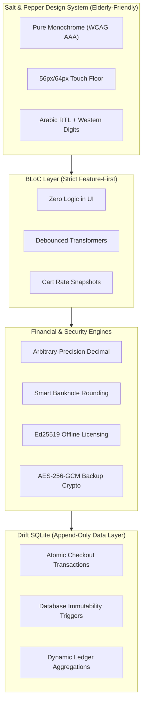

# 📚 Dukkani Documentation Hub & Portfolio Showcase

Welcome to the technical documentation and case study hub for **Dukkani (دكّاني)** — an offline-first Point of Sale (POS), inventory management, and inflation-protected customer debt ledger engineered specifically for neighborhood grocery stores in Syria.

This documentation suite is organized for hiring managers, senior software engineers, and product stakeholders who want to inspect the architecture, engineering decisions, and domain problem-solving that went into building Dukkani.

---

## 🧭 Navigation & Modules

| Document | Primary Audience | Description & Key Topics |
| :--- | :--- | :--- |
| **[CASE_STUDY.md](./CASE_STUDY.md)** | Hiring Managers, Product Leads, Clients | High-level case study: Problem context (Syrian hyperinflation & currency redenomination), solution pillars, operational impact, and project timeline. |
| **[ARCHITECTURE.md](./ARCHITECTURE.md)** | Senior Engineers, Tech Leads | Clean Architecture layers, Strict BLoC state management rules, Drift SQLite schema, ER diagram, and atomic transactions. |
| **[FINANCIAL_AND_SECURITY.md](./FINANCIAL_AND_SECURITY.md)** | Tech Leads, Backend/FinTech Engineers | Zero-floating-point `Decimal` math engine, smart Syrian banknote rounding algorithm, append-only debt ledger, Ed25519 offline asymmetric licensing, and PBKDF2/AES-256-GCM backups. |
| **[DESIGN_SYSTEM.md](./DESIGN_SYSTEM.md)** | UI/UX Designers, Product Engineers | "Salt & Pepper" elderly-friendly design system: 56px/64px touch targets, zero-elevation monochrome palette, Arabic RTL with Western numerals, and 320px–Tablet responsiveness. |
| **[FEATURES_AND_FLOWS.md](./FEATURES_AND_FLOWS.md)** | Product Managers, Evaluators | Complete walkthrough of all 7 app modules with operational flows, business logic rules, and screenshot placeholders. |
| **[ADR_AND_TESTING.md](./ADR_AND_TESTING.md)** | Architects, QA / Senior Engineers | 5 Architecture Decision Records (ADRs) and comprehensive automated testing strategy across 44 test suites. |
| **[PORTFOLIO_SNIPPETS.md](./PORTFOLIO_SNIPPETS.md)** | Portfolio Website & Resume Copy | Ready-to-copy project card summaries, structured JSON/MDX frontmatter, resume bullet points, and 4 STAR interview stories. |
| **[Screenshot Guide](./assets/screenshots/README.md)** | Content Creators, Showcase Prep | Standardized shot list, file naming conventions, and layout dimensions for showcase images. |

---

## ⚡ Engineering Highlights at a Glance

### Core Metrics & Guarantees

- **Zero Floating-Point Financial Math:** `0` uses of `double` or `num` for currency amounts; 100% of money math is calculated with `Decimal` and stored as `TEXT` in SQLite.
- **Append-Only Debt Ledger:** Customer balances are never stored in a mutable column; balances are calculated on-the-fly via SQL aggregation (`SUM(charges) - SUM(payments)`).
- **SQLite-Level Tamper Resistance:** 4 native database triggers prevent unauthorized record deletion or modification on financial and invoice history.
- **100% Offline Independence:** Zero internet dependencies for license validation, barcode lookups, WhatsApp statement generation, or encrypted database backups.
- **Automated Test Coverage:** 44 comprehensive test files across financial math, in-memory Drift SQLite DAOs, BLoC state transitions, and responsive widget compliance.

